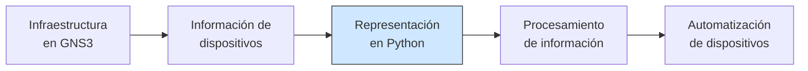
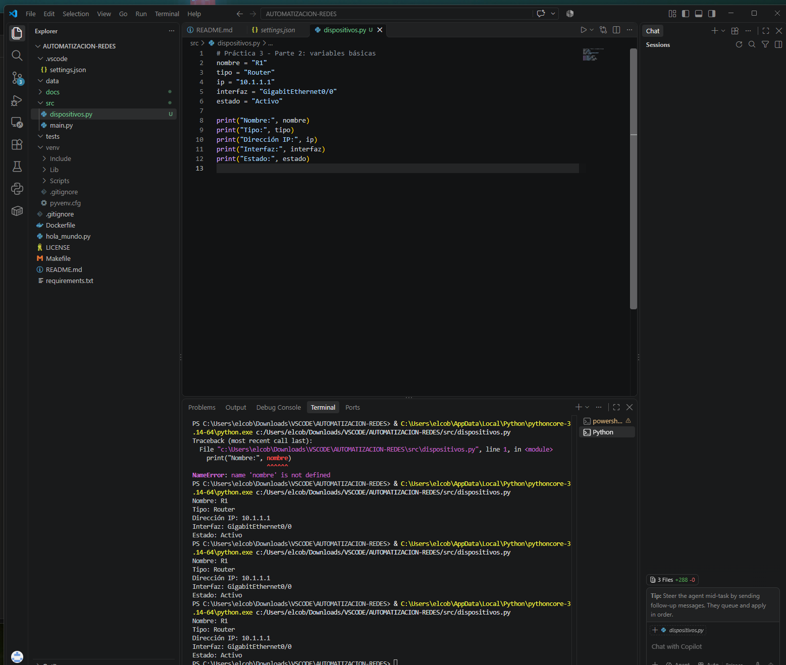
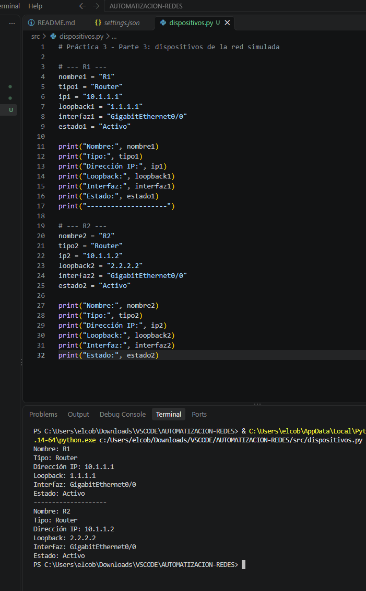
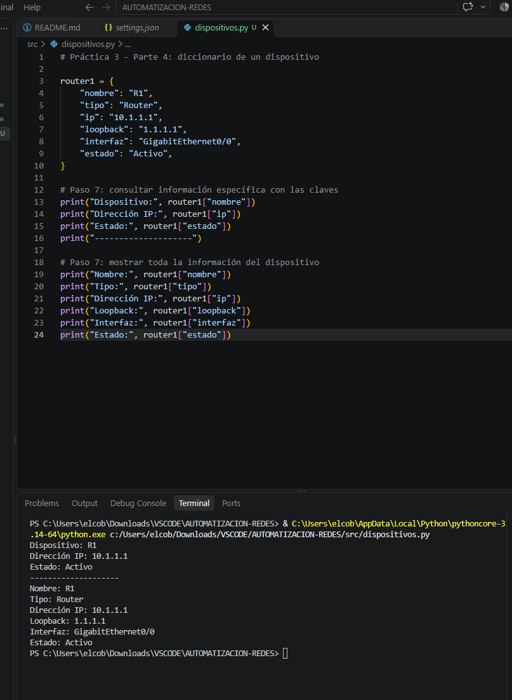
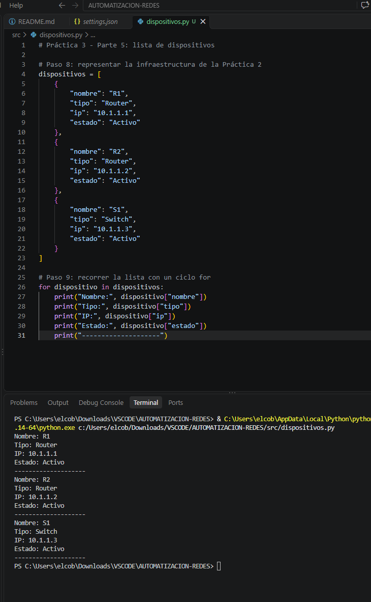
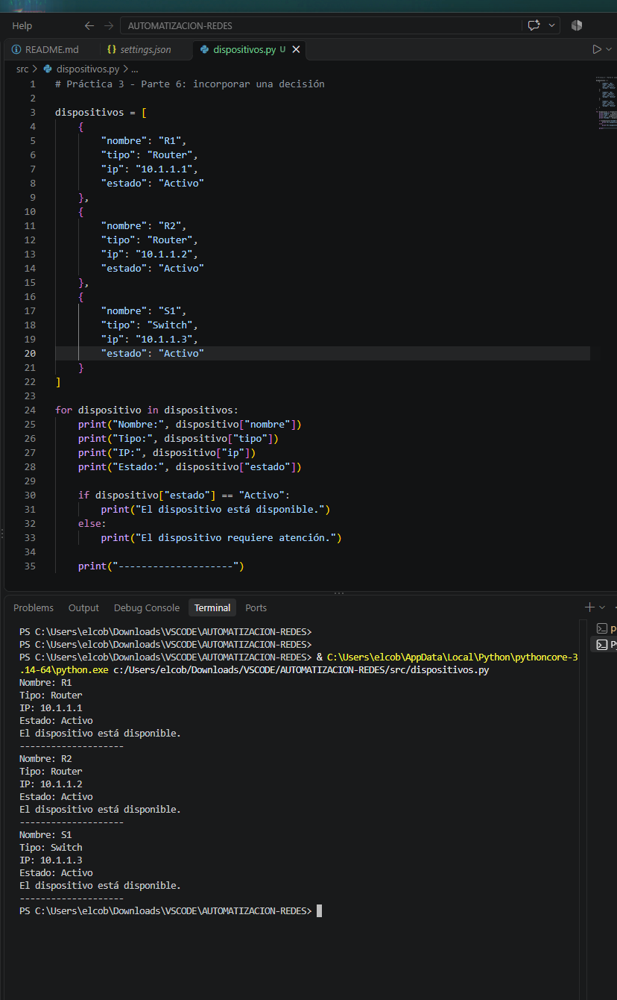
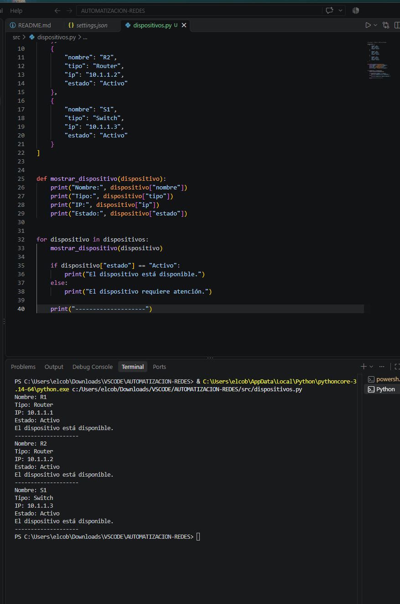
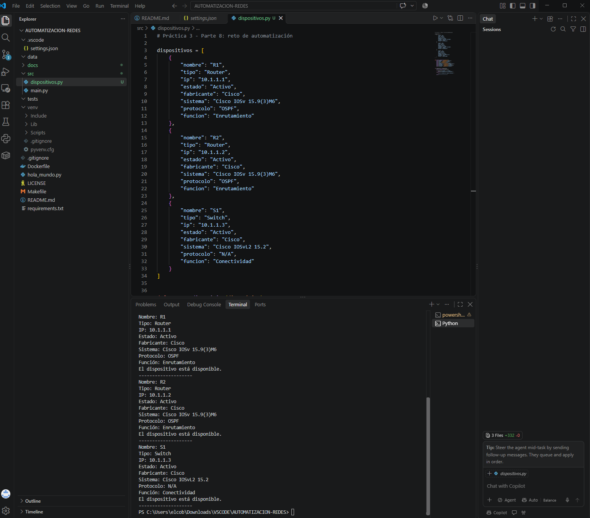
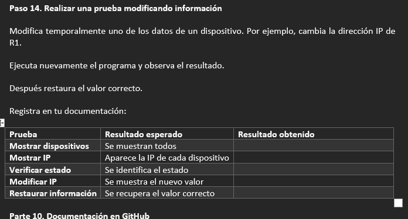

# Práctica 03 — Primer programa de Python para representar información de dispositivos

| Campo | Detalle |
|-------|---------|
| **Asignatura** | Automatización de Infraestructura Digital I |
| **Práctica** | 3 de 12 |
| **Grupo** | 3IRI3V |
| **Fecha** | 18 de octubre de 2026 |
| **Equipo** | Carlos Martin Cobos Hernandez, Erik Osiel Camarillo Espinoza y José Emilio Montes Villarreal |

## Propósito

En esta práctica iniciamos la **segunda etapa del proyecto integrador**: el desarrollo de software. Escribimos un programa sencillo en **Python** que representa y muestra la información de los dispositivos de la red que construimos en la Práctica 2 (`MiSegundaTopologia`: R1, R2 y S1).

**Importante:** en esta práctica todavía **no hay conexión real** entre Python y GNS3. Los datos están escritos dentro del programa. Lo que se busca es entender cómo Python puede **almacenar, organizar, modificar y mostrar** información de una infraestructura antes de usar bibliotecas de automatización.

El flujo de trabajo fue:

> Preparar el repositorio → Variables → Diccionarios → Listas → Ciclo y condicional → Funciones → Probar → Documentar → Subir a GitHub



*(La Práctica 3 corresponde al tercer bloque: representación en Python.)*

## Estructura de la carpeta

```
AUTOMATIZACION-REDES/
├── README.md                  ← avance del proyecto integrador
├── requirements.txt
├── src/
│   └── dispositivos.py        ← programa de esta práctica
└── docs/
    └── practica-03/
        ├── README.md          ← este archivo
        └── evidencias/
            ├── Evidencia_1.png   ← estructura del repositorio, código de variables y su ejecución
            ├── Evidencia_2.png   ← R1 y R2 representados
            ├── Evidencia_3.png   ← diccionario de R1
            ├── Evidencia_4.png   ← lista de dispositivos, ciclo for y ejecución
            ├── Evidencia_5.png   ← condicional if
            ├── Evidencia_6.png   ← función mostrar_dispositivo()
            ├── Evidencia_7.png   ← código final con datos adicionales y su ejecución
            └── Evidencia_8.png   ← repositorio actualizado en GitHub
```

---

## Conceptos utilizados

| Concepto | Para qué lo usamos en la práctica |
|----------|-----------------------------------|
| **Variables** | Guardar un dato de un dispositivo (`nombre`, `tipo`, `ip`, `interfaz`, `estado`). |
| **Tipos de datos** | Todos los datos de los dispositivos son cadenas de texto (`str`), incluida la IP porque lleva puntos. Además se usaron `dict` (diccionario) y `list` (lista). |
| **`print()`** | Mostrar la información en pantalla de forma organizada. |
| **Diccionarios** | Agrupar todos los datos de un dispositivo y consultarlos por clave (`router1["ip"]`). |
| **Listas** | Guardar varios dispositivos en una sola variable (`dispositivos`). |
| **Ciclo `for`** | Recorrer la lista y repetir el mismo código para cada dispositivo. |
| **Condicional `if`** | Decidir si un dispositivo está disponible o requiere atención según su estado. |
| **Funciones** | Reutilizar código: `mostrar_dispositivo()` y `buscar_dispositivo()`. |

---

## Dispositivos representados (de la Práctica 2)

Se usaron los dispositivos de la **Topología 02**, con los mismos nombres e IPs que se configuraron en GNS3.

| Dispositivo | Tipo | Dirección IP | Interfaz | Loopback | Estado | Función |
|-------------|------|--------------|----------|----------|--------|---------|
| R1 | Router (Cisco IOSv 15.9(3)M6) | 10.1.1.1 | GigabitEthernet0/0 | 1.1.1.1 | Activo | Enrutamiento |
| R2 | Router (Cisco IOSv 15.9(3)M6) | 10.1.1.2 | GigabitEthernet0/0 | 2.2.2.2 | Activo | Enrutamiento |
| S1 | Switch multicapa (Cisco IOSvL2 15.2) | 10.1.1.3 | VLAN 1 (SVI) | N/A | Activo | Conectividad |

---

## Desarrollo paso a paso

### Parte 1 — Preparar el espacio de trabajo

Se abrió el repositorio en Visual Studio Code, se actualizó con `git pull` y se crearon `src/dispositivos.py` y la carpeta `docs/practica-03/` con su `README.md` y `evidencias/`.



### Parte 2 — Variables y `print()`

Primero se representó un dispositivo con variables sueltas:

```python
nombre = "R1"
tipo = "Router"
ip = "10.1.1.1"
interfaz = "GigabitEthernet0/0"
estado = "Activo"

print("Nombre:", nombre)
print("Tipo:", tipo)
print("Dirección IP:", ip)
print("Interfaz:", interfaz)
print("Estado:", estado)
```

| Variable | ¿Qué información representa? | Tipo de dato | ¿Por qué es importante para administrar una red? |
|----------|------------------------------|--------------|--------------------------------------------------|
| `nombre` | Identificador del equipo | `str` | Permite distinguir cada dispositivo de la topología |
| `tipo` | Rol del equipo (router, switch) | `str` | Define qué funciones y comandos aplican al equipo |
| `ip` | Dirección IP de la interfaz | `str` | Es la dirección con la que se alcanza y administra el equipo |
| `interfaz` | Interfaz de red principal | `str` | Indica por dónde se conecta y dónde se aplica la configuración |
| `estado` | Condición operativa | `str` | Indica si el equipo está disponible o requiere atención |

En la misma captura se ven el código (Evidencia 2) y la ejecución correcta (Evidencia 3):


### Parte 3 — Dispositivos de la red simulada

Se modificó el programa para representar R1 y R2 con los datos reales de la Práctica 2 (IP, loopback, interfaz y estado).



### Parte 4 — Diccionario

Toda la información de un dispositivo se agrupó en un **diccionario**, y se consultó con sus claves:

```python
router1 = {
    "nombre": "R1",
    "tipo": "Router",
    "ip": "10.1.1.1",
    "loopback": "1.1.1.1",
    "interfaz": "GigabitEthernet0/0",
    "estado": "Activo",
}

print("Dispositivo:", router1["nombre"])
print("Dirección IP:", router1["ip"])
print("Estado:", router1["estado"])
```



### Parte 5 — Lista de dispositivos y ciclo `for`

Los tres dispositivos de la topología se guardaron en una **lista de diccionarios** y se recorrieron con un ciclo `for`:

```python
for dispositivo in dispositivos:
    print("Nombre:", dispositivo["nombre"])
    print("Tipo:", dispositivo["tipo"])
    print("IP:", dispositivo["ip"])
    print("Estado:", dispositivo["estado"])
    print("--------------------")
```



### Parte 6 — Decisión con `if`

```python
for dispositivo in dispositivos:
    ...
    if dispositivo["estado"] == "Activo":
        print("El dispositivo está disponible.")
    else:
        print("El dispositivo requiere atención.")
```

Al cambiar intencionalmente el estado de un dispositivo a `"Fuera de servicio"`, el programa dejó de decir que estaba disponible y mostró **"El dispositivo requiere atención."**



### Parte 7 — Función

```python
def mostrar_dispositivo(dispositivo):
    print("Nombre:", dispositivo["nombre"])
    print("Tipo:", dispositivo["tipo"])
    print("IP:", dispositivo["ip"])
    ...
```

Usar una función permite escribir el código **una sola vez** y reutilizarlo para cualquier dispositivo; si se quiere cambiar la forma de mostrar los datos, se modifica en un solo lugar.



### Parte 8 — Reto de automatización: datos adicionales

A cada dispositivo se le agregaron más datos y se actualizó la función para mostrarlos:

| Dato nuevo | R1 | R2 | S1 |
|------------|----|----|----|
| `fabricante` | Cisco | Cisco | Cisco |
| `sistema` | Cisco IOSv 15.9(3)M6 | Cisco IOSv 15.9(3)M6 | Cisco IOSvL2 15.2 |
| `protocolo` | OSPF (proceso 1, área 0) | OSPF (proceso 1, área 0) | N/A |
| `funcion` | Enrutamiento | Enrutamiento | Conectividad |



### Reto final — Buscar un dispositivo por nombre

Se creó la función `buscar_dispositivo()`, que recorre la lista y devuelve el dispositivo cuyo nombre coincide (sin importar mayúsculas o minúsculas), o `None` si no existe:

```python
def buscar_dispositivo(lista, nombre_buscado):
    for dispositivo in lista:
        if dispositivo["nombre"].lower() == nombre_buscado.lower():
            return dispositivo
    return None
```

Ejemplo de ejecución:

```
Ingrese el nombre del dispositivo: R1
Dispositivo encontrado:
Nombre: R1
Tipo: Router
IP: 10.1.1.1
Loopback: 1.1.1.1
Interfaz: GigabitEthernet0/0
Estado: Activo
...
```

Si el nombre no existe, el programa muestra `Dispositivo no encontrado.`

### Repositorio actualizado en GitHub



---

## Pruebas y verificación

| Prueba | Resultado esperado | Resultado obtenido |
|--------|--------------------|--------------------|
| Mostrar dispositivos | Se muestran todos | Se mostraron R1, R2 y S1 con toda su información |
| Mostrar IP | Aparece la IP de cada dispositivo | Aparecieron 10.1.1.1, 10.1.1.2 y 10.1.1.3 |
| Verificar estado | Se identifica el estado | Con `Activo` mostró "disponible"; con `Fuera de servicio` mostró "requiere atención" |
| Modificar IP | Se muestra el nuevo valor | Se cambió la IP de R1 a 10.1.1.99 y el programa mostró `IP: 10.1.1.99` |
| Restaurar información | Se recupera el valor correcto | Se regresó la IP de R1 a 10.1.1.1 y el programa volvió a mostrar `IP: 10.1.1.1` |
| Buscar dispositivo (reto) | Se encuentra el dispositivo indicado | Al escribir `R1` o `r1` se mostró R1; con un nombre inexistente mostró "no encontrado" |

## Bitácora de problemas y soluciones

> Reemplacen estos renglones por los problemas que **realmente** tuvieron.

| Problema encontrado | Posible causa | Solución aplicada | Resultado |
|---------------------|---------------|-------------------|-----------|
| *(ejemplo)* `SyntaxError` al ejecutar | Faltó una coma o una comilla en el diccionario | Revisar la línea que marca el error y corregirla | El programa corrió bien |
| *(ejemplo)* `KeyError` al mostrar un dispositivo | La función pedía una clave que no estaba en todos los diccionarios | Agregar la clave a todos los dispositivos | Se mostró la información completa |
| | | | |

## Integración con el proyecto

**a) ¿Por qué es útil representar la información de los dispositivos mediante un programa?**
Porque los datos quedan ordenados y se pueden consultar, modificar y reutilizar. Además es la base para que en el futuro el programa los procese y automatice tareas.

**b) ¿Qué ventaja ofrece utilizar un diccionario para representar un dispositivo?**
Agrupa todos los datos de un equipo en una sola estructura y se consultan por el nombre de la clave (`dispositivo["ip"]`) en lugar de por posición.

**c) ¿Qué ventaja ofrece utilizar una lista para representar varios dispositivos?**
Permite manejar toda la infraestructura como una colección: se pueden agregar o quitar equipos y recorrerlos fácilmente.

**d) ¿Qué tarea permite realizar el ciclo `for`?**
Repetir la misma operación para cada dispositivo de la lista (mostrar, verificar el estado o buscar) sin copiar el código varias veces.

**e) ¿Para qué se utilizó la estructura `if`?**
Para tomar decisiones: saber si un dispositivo está disponible o requiere atención según su estado, y comparar nombres en la búsqueda.

**f) ¿Qué ventaja tiene utilizar una función?**
Evita repetir código, facilita corregir errores en un solo lugar y hace el programa más fácil de leer.

**g) ¿Qué información de los dispositivos podría obtener automáticamente un programa en una etapa posterior?**
Las IP de las interfaces, el estado real de los puertos, los vecinos OSPF, la tabla de rutas, el nombre del equipo y la versión del sistema (la misma información que en la Práctica 2 revisamos con comandos `show`).

**h) ¿Qué diferencia existe entre representar la información de un dispositivo y obtenerla directamente de él?**
Lo representado es información escrita a mano que puede quedar desactualizada o incorrecta; lo obtenido del dispositivo refleja su estado real en ese momento.

**i) ¿Cómo podría evolucionar este programa para convertirse en una herramienta de automatización de redes?**
Leyendo los datos desde archivos (por ejemplo JSON), conectándose a los equipos por SSH o por API y ejecutando comandos o aplicando configuraciones de forma automática en todos los dispositivos.

**j) ¿Qué relación existe entre esta práctica, la Práctica 2 y las siguientes prácticas del proyecto integrador?**
En la Práctica 2 construimos la red en GNS3, en esta práctica la representamos en Python, y en las siguientes usaremos esa representación para conectarnos a los dispositivos, procesar su información y automatizarlos.

## Conclusiones

> **Nota:** la guía pide una conclusión **individual de al menos 8 líneas**. Este es un borrador de equipo: cada integrante debe adaptarlo con su propia experiencia.

En esta práctica aprendimos los conceptos básicos de Python para manejar información: variables, tipos de datos, `print()`, diccionarios, listas, el ciclo `for`, el condicional `if` y las funciones. Representamos los dispositivos de la red de la Práctica 2 (R1, R2 y S1) primero con variables sueltas y después con diccionarios dentro de una lista, lo que hizo el programa más ordenado y fácil de recorrer.

Las dificultades que tuvimos fueron *(describir las reales)*, y las resolvimos *(explicar cómo)*. También creamos funciones para mostrar la información y para buscar un dispositivo por su nombre, y comprobamos que así no se repite código.

Entendimos que Python sirve para la automatización de redes porque permite organizar y procesar la información de los equipos en lugar de revisarlos uno por uno. Este programa será la base de las siguientes etapas: después leeremos los datos desde archivos, nos conectaremos a los dispositivos de GNS3 y automatizaremos consultas y configuraciones.

## Bibliografía

- Guía de la Práctica 3 de Automatización de Infraestructura Digital I: *Primer programa de Python para representar información de dispositivos*.
- Python Software Foundation. *The Python Tutorial* — https://docs.python.org/es/3/tutorial/
