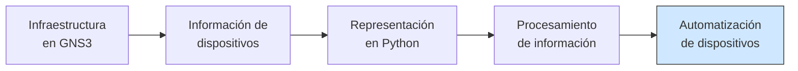
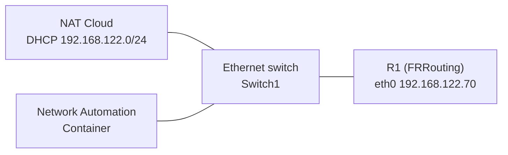
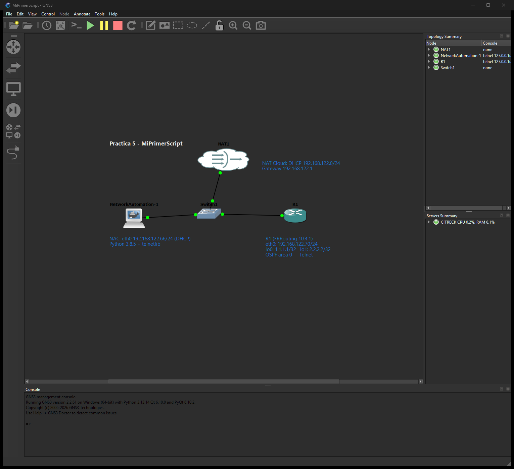
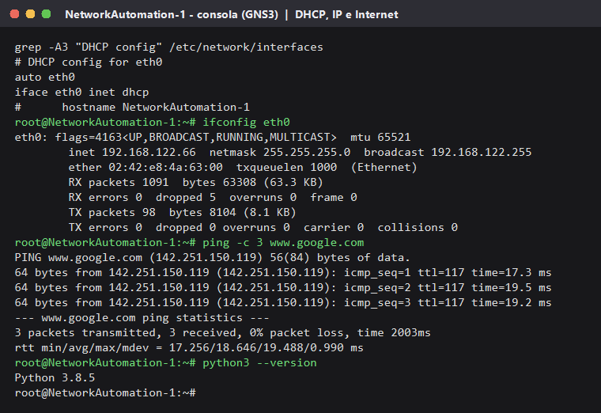
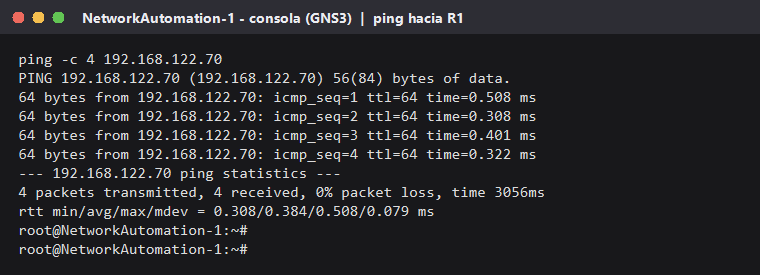
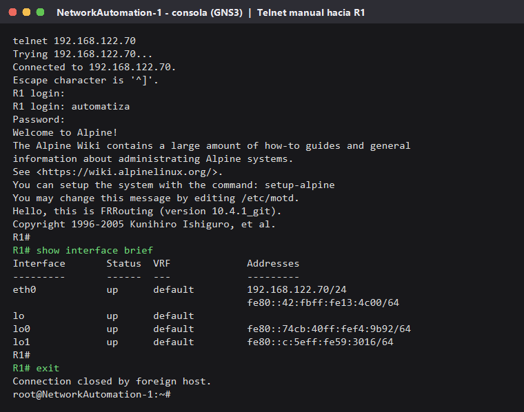
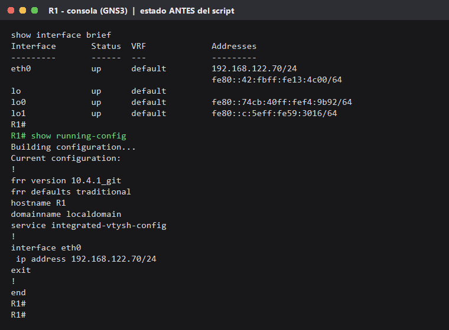
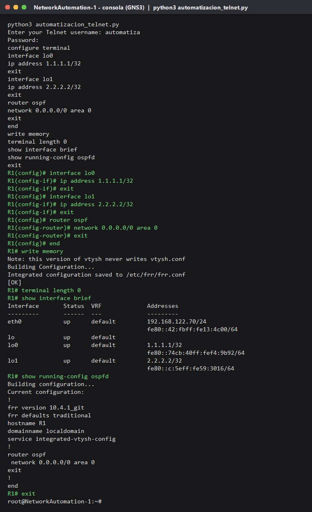
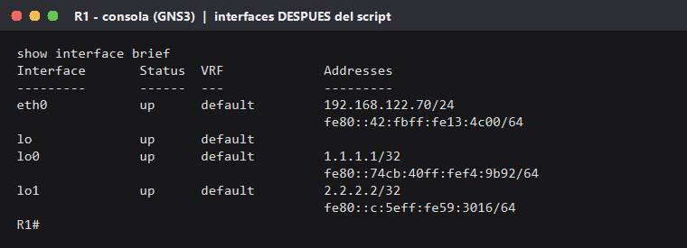
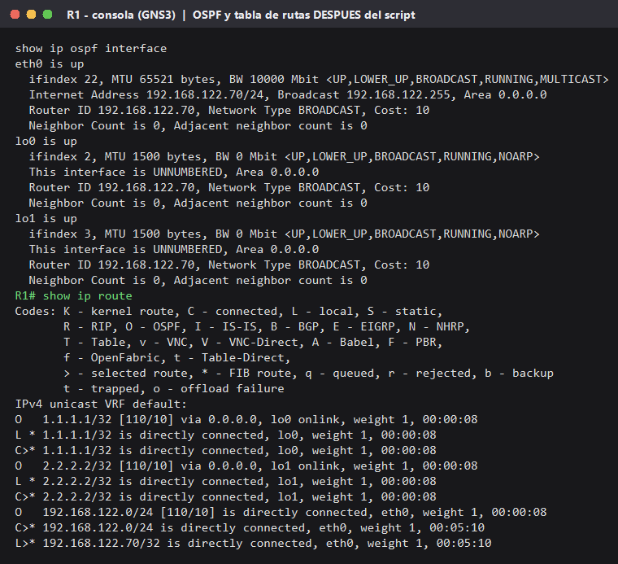

# Práctica 05 — Mi primer script en Python para la automatización de redes

| Campo | Detalle |
|-------|---------|
| **Asignatura** | Automatización de Infraestructura Digital I |
| **Profesor** | Victor Alejandro Galvan Guerra |
| **Práctica** | 5 de 12 |
| **Grupo** | 3IRI3V |
| **Fecha** | 26 de octubre de 2026 |
| **Duración** | 3 horas |
| **Equipo** | Carlos Martín Cobos Hernández, Erik Osiel Camarillo Espinoza y José Emilio Montes Villarreal |

> **Cambio respecto a la guía.** No contamos con la imagen del router **Cisco IOSv** ni del switch **IOSvL2**: son software de Cisco con licencia (se obtienen con una suscripción de Cisco Modeling Labs) y no pudimos conseguirlas. Para no detener la práctica, **R1 se implementó con FRRouting 10.4.1**, un router de software libre con una línea de comandos muy parecida a la de Cisco. El resto se hizo como pide la guía: GNS3, Network Automation Container, NAT Cloud, Telnet, `telnetlib`, Loopback 0, Loopback 1 y OSPF en el área 0. El script trae también los comandos de Cisco IOS, así que con la imagen IOSv solo hay que cambiar una línea (`PLATAFORMA = "cisco_ios"`).

## Objetivo

Preparar un entorno de red en GNS3 para la automatización y crear un script de Python que se conecte por **Telnet** a un router para aplicarle configuración (interfaces Loopback y OSPF), verificar los cambios en el router y documentar todo en GitHub.

## Relación con las prácticas anteriores

| Práctica | Qué hicimos | Cómo se usa aquí |
|----------|-------------|------------------|
| 1 | Preparamos la estación de trabajo (Python, Git, GNS3, VMware) | Es el entorno donde corre la topología |
| 2 | Construimos y configuramos redes en GNS3 a mano | Usamos los mismos comandos (IP, loopback, OSPF), pero ahora los envía Python |
| 3 | Representamos dispositivos con diccionarios y listas en Python | El script guarda los comandos en una lista y la recorre con `for` |
| 4 | Buscamos recursos y foros de Python, GNS3 y Netmiko | Los consultamos para resolver los problemas de esta práctica |



*(En la Práctica 3 estábamos en "Representación en Python"; con esta práctica llegamos a "Automatización de dispositivos": el programa ya no solo describe al router, ahora le envía configuración.)*

## Estructura de la carpeta

```
AUTOMATIZACION-REDES/
├── README.md                     ← avance del proyecto integrador
├── src/
│   ├── dispositivos.py           ← Práctica 3
│   └── automatizacion_telnet.py  ← script de esta práctica
└── docs/
    └── practica-05/
        ├── README.md             ← este archivo
        └── evidencias/
            ├── 01-topologia.png          ← topología MiPrimerScript en GNS3
            ├── 02-nac-ip.png             ← DHCP del NAC, IP, Internet y versión de Python
            ├── 03-ping-r1.png            ← ping del NAC hacia R1
            ├── 04-telnet-manual.png      ← Telnet manual del NAC hacia R1
            ├── 05-ejecucion-script.png   ← ejecución de automatizacion_telnet.py
            ├── 06-r1-antes.png           ← R1 antes del script
            ├── 07-loopbacks.png          ← Loopback 0 y 1 creadas
            └── 08-ospf.png               ← OSPF activo y rutas OSPF
```

## Topología y direccionamiento

Proyecto de GNS3: **`MiPrimerScript`**



| Dispositivo | Interfaz | Dirección IP | Cómo se asignó |
|-------------|----------|--------------|----------------|
| NAT Cloud | — | 192.168.122.1 (puerta de enlace) | Servidor DHCP de GNS3 |
| NAC | eth0 | 192.168.122.66 /24 | DHCP |
| R1 | eth0 (equivale a Gi0/0) | 192.168.122.70 /24 | Manual |
| R1 | lo0 (Loopback 0) | 1.1.1.1 /32 | Por el script |
| R1 | lo1 (Loopback 1) | 2.2.2.2 /32 | Por el script |

> El switch IOSvL2 de la guía no se incluyó porque tampoco se tenía su imagen. En esta práctica solo formaba parte del dibujo (no se configura), así que R1 se conectó directo al Ethernet switch y el funcionamiento es el mismo.

### Entorno de GNS3

La GNS3 VM de VMware no arrancaba en la computadora porque Windows tiene **Hyper-V** activo (lo usan WSL2 y Docker Desktop) y VMware no puede pasarle la virtualización (VT-x) a la VM. En lugar de desactivar Hyper-V, el **servidor de GNS3 2.2.61 se instaló en Ubuntu dentro de WSL2**, que sí tiene KVM, con QEMU, Docker, uBridge, Dynamips y libvirt (red NAT 192.168.122.0/24). La interfaz gráfica de GNS3 en Windows se conecta a ese servidor.

### Configuración manual de R1 (antes del script)

Antes de automatizar comprobamos que todo funcionara a mano (pasos 16 a 19 de la guía). En la consola de R1:

```
configure terminal
 hostname R1
 interface eth0
  ip address 192.168.122.70/24
  no shutdown
  exit
 end
write memory
```

Para el acceso Telnet (paso 17) se creó un usuario de laboratorio en R1. En FRR el usuario se crea en el sistema Linux del router y su "shell" es la CLI del router (`vtysh`), así que al entrar por Telnet se llega directo a `R1#`. Por eso no hace falta el paso 21 (contraseña de *enable*).

> Las credenciales se omiten a propósito. Son de laboratorio y no se suben a GitHub.

## Versión de Python

| Equipo | Versión | ¿Trae `telnetlib`? |
|--------|---------|--------------------|
| NAC (GNS3) | Python 3.8.5 | Sí |
| PC de desarrollo (Windows) | Python 3.14.3 | No (se quitó en 3.13) |

`telnetlib` se retiró de la biblioteca estándar en **Python 3.13** ([PEP 594](https://peps.python.org/pep-0594/)). Por eso el script se ejecuta en el NAC. El script revisa esto al inicio y, si falta, explica cómo resolverlo (usar Python 3.12 o anterior, o instalar `standard-telnetlib`) en vez de fallar con un error confuso.

## Explicación del script

Código completo: [`src/automatizacion_telnet.py`](../../src/automatizacion_telnet.py)

Partimos del ejemplo de la documentación de `telnetlib` (paso 15), lo adaptamos a R1 (pasos 20 y 22) y le agregamos lo que pide el paso 27.

| Parte | Qué hace |
|-------|----------|
| `import telnetlib` dentro de `try` | Carga la biblioteca de Telnet; si no existe, explica cómo resolverlo y termina |
| `HOST = "192.168.122.70"` | IP de R1 a la que se conecta |
| `PLATAFORMA = "frr"` | Elige la lista de comandos: `"frr"` (usado) o `"cisco_ios"` (para IOSv) |
| `COMANDOS = [...]` | Lista con la configuración; se recorre con un ciclo `for` como en la Práctica 3 |
| `input()` y `getpass.getpass()` | Piden usuario y contraseña sin mostrar la contraseña |
| `telnetlib.Telnet(HOST)` | Abre la sesión Telnet con R1 |
| `read_until(...)` | Espera a que R1 pida el usuario, la contraseña y muestre su prompt antes de escribir |
| `write(...)` | Envía cada comando como si lo tecleáramos en la consola |
| `interface lo0` / `lo1` + `ip address` | Asigna 1.1.1.1/32 a Loopback 0 y 2.2.2.2/32 a Loopback 1 |
| `router ospf` + `network 0.0.0.0/0 area 0` | Activa OSPF en **todas** las interfaces, área 0 |
| `write memory` | Guarda la configuración en R1 |
| `show interface brief` / `show running-config ospfd` | Imprime la verificación al final |
| `read_all()` | Recoge todo lo que respondió R1 y lo muestra en el NAC |

Cambios respecto al ejemplo de la guía:

- **Ninguna contraseña está escrita en el código**: se piden al ejecutar con `getpass`.
- **El script espera el prompt de R1** (`read_until`) antes de mandar la configuración, para no escribir comandos mientras el router todavía está iniciando la sesión.

**Sobre OSPF:** FRR escribe la red en formato CIDR (`0.0.0.0/0`). En Cisco IOS el mismo comando se escribe con wildcard: `network 0.0.0.0 255.255.255.255 area 0`. Las dos formas significan "cualquier dirección", por eso OSPF se activa en eth0, lo0 y lo1.

### Comandos de la guía (Cisco) y su equivalente en FRR

| Cisco IOSv (guía) | FRRouting (usado) |
|-------------------|-------------------|
| `interface g0/0` | `interface eth0` |
| `ip address 192.168.122.70 255.255.255.0` | `ip address 192.168.122.70/24` |
| `username victor password ...` + `line vty 0 4` / `login local` | Usuario del sistema con la CLI `vtysh` como shell + servidor Telnet |
| `enable` + `enable password` | No aplica: la sesión entra directo a `R1#` |
| `interface loopback 0` | `interface lo0` |
| `router ospf 1` / `network 0.0.0.0 255.255.255.255 area 0` | `router ospf` / `network 0.0.0.0/0 area 0` |
| `show ip interface brief` | `show interface brief` |
| `debug telnet` | No existe en FRR; la sesión se comprobó con la salida del script y con `show` en R1 |
| `wr` | `write memory` |

## Desarrollo y evidencias

> Las capturas de consola (02 a 08) son la salida real de las consolas del NAC y de R1 en GNS3, convertida a imagen. No muestran contraseñas.

### 1. Topología en GNS3 (pasos 1 a 9)



### 2. IP del NAC por DHCP e Internet (pasos 10 a 14)

Al inicio `ifconfig` solo mostraba una dirección IPv6. Se quitaron los comentarios a `auto eth0` e `iface eth0 inet dhcp` en `/etc/network/interfaces`, se detuvo e inició el NAC y obtuvo **192.168.122.66** de la NAT Cloud. El ping a www.google.com respondió (0 % de pérdida). La versión de Python del NAC es **3.8.5**.



### 3. Conectividad del NAC hacia R1 (paso 16)



### 4. Acceso Telnet manual (pasos 17 a 19)



### 5. Estado de R1 antes del script

Solo tiene la IP de eth0; lo0 y lo1 no tienen dirección y no hay OSPF.



### 6. Ejecución del script (pasos 23, 24 y 27)

```
python3 automatizacion_telnet.py
```



### 7. Verificación en R1 (pasos 26 y 27)

`show interface brief`: lo0 con 1.1.1.1/32 y lo1 con 2.2.2.2/32, ambas *up*.



`show ip ospf interface` y `show ip route`: OSPF está activo en eth0, lo0 y lo1 (área 0.0.0.0, Router ID 192.168.122.70), y en la tabla de rutas aparecen las rutas `O` (OSPF) de 1.1.1.1/32, 2.2.2.2/32 y 192.168.122.0/24. No hay vecinos OSPF porque R1 es el único router de la topología.



### Resumen de cambios en R1

| Antes del script | Después del script |
|------------------|--------------------|
| eth0 con 192.168.122.70/24 | eth0 con 192.168.122.70/24 |
| lo0 y lo1 sin dirección IPv4 | lo0 = 1.1.1.1/32 y lo1 = 2.2.2.2/32 |
| Sin protocolo de enrutamiento | `router ospf` con `network 0.0.0.0/0 area 0` (eth0, lo0 y lo1 en el área 0) |
| Configuración sin esas líneas | Guardada en `/etc/frr/frr.conf` con `write memory` |

## Tabla de pruebas

| # | Prueba | Comando | Resultado esperado | Resultado obtenido |
|---|--------|---------|--------------------|--------------------|
| 1 | NAC recibe IP | `ifconfig eth0` | IPv4 en 192.168.122.0/24 | 192.168.122.66/24 por DHCP |
| 2 | NAC tiene Internet | `ping www.google.com` | Hay respuesta | 3 de 3 respuestas, 0 % de pérdida |
| 3 | NAC alcanza a R1 | `ping 192.168.122.70` | Hay respuesta | 4 de 4 respuestas, 0 % de pérdida |
| 4 | Telnet manual | `telnet 192.168.122.70` | Pide usuario y contraseña y entra a R1 | Pidió `login` y `Password` y entró a `R1#` |
| 5 | Versión de Python | `python3 --version` | Menor a 3.13 (trae `telnetlib`) | Python 3.8.5 |
| 6 | Ejecutar el script | `python3 automatizacion_telnet.py` | Termina sin errores y muestra la salida de R1 | Aplicó todos los comandos, guardó (`[OK]`) y cerró la sesión |
| 7 | Loopback 0 | `show interface brief` | lo0 1.1.1.1/32 up | lo0 up con 1.1.1.1/32 |
| 8 | Loopback 1 | `show interface brief` | lo1 2.2.2.2/32 up | lo1 up con 2.2.2.2/32 |
| 9 | OSPF | `show ip ospf interface`, `show ip route` | OSPF en área 0 en todas las interfaces | eth0, lo0 y lo1 en el área 0.0.0.0; rutas `O` en la tabla |
| 10 | Python sin `telnetlib` | Ejecutar en Python 3.14 (PC) | Mensaje que indica cómo resolverlo | Mostró el mensaje y terminó sin traceback |

## Problemas y soluciones

| Problema | Causa | Solución | Resultado |
|----------|-------|----------|-----------|
| No teníamos las imágenes Cisco IOSv e IOSvL2 | Son software de Cisco con licencia (Cisco Modeling Labs) | R1 se implementó con FRRouting 10.4.1 y el script quedó listo para Cisco con `PLATAFORMA = "cisco_ios"` | Se completó la práctica |
| La GNS3 VM no arrancaba en VMware ("Virtualized Intel VT-x/EPT is not supported") | Hyper-V activo en Windows (WSL2 y Docker Desktop) | Se instaló el servidor de GNS3 en Ubuntu de WSL2, que sí tiene KVM, y la GUI se conectó a él | GNS3 funciona sin desactivar Hyper-V |
| GNS3 no podía crear el switch ni el NAC en el servidor nuevo ("Could not find Dynamips", "No busybox executable") | Faltaban dependencias en Ubuntu | Se instalaron `dynamips` y `busybox-static` | Los nodos arrancaron |
| El NAC solo tenía IPv6 | Las líneas de DHCP estaban comentadas en `/etc/network/interfaces` | Quitar el `#` a `auto eth0` e `iface eth0 inet dhcp` y reiniciar el NAC | Obtuvo 192.168.122.66 |
| `ModuleNotFoundError: No module named 'telnetlib'` en la PC | `telnetlib` se quitó en Python 3.13 (PEP 594) | Ejecutar el script en el NAC (Python 3.8.5); el script avisa en vez de tronar | Resuelto |
| Primer intento del script: `EOFError: telnet connection closed` | Al escribir el usuario en la consola se mandó un Enter doble, y `getpass` recibió una contraseña vacía; R1 rechazó el login y cerró la conexión | Volver a ejecutar escribiendo usuario y contraseña con un solo Enter | El script se ejecutó correctamente |
| El ejemplo de la guía tenía la contraseña de enable escrita en el código | El ejemplo la tenía fija | Pedir las contraseñas con `getpass` al ejecutar | No hay contraseñas en GitHub |

## Conclusiones individuales

> **Borradores.** La guía pide una conclusión **individual**: cada quien debe revisar la suya y ajustarla con lo que vivió en la práctica.

**Carlos Martín Cobos Hernández**
En la Práctica 3 nuestro programa solo describía a los routers con datos escritos a mano; en esta práctica el programa se conectó por primera vez a un router en GNS3 y le cambió la configuración: creó dos loopbacks y activó OSPF. Me di cuenta de que un script no hace nada mágico: envía los mismos comandos que escribimos en la consola, pero en orden y sin errores de dedo. También aprendí que primero hay que probar todo a mano (ping y Telnet) antes de automatizar, y que el entorno importa: tuvimos que mover el servidor de GNS3 a WSL porque la VM no arrancaba con Hyper-V.

**Erik Osiel Camarillo Espinoza**
Pasar de representar dispositivos a configurarlos me hizo entender para qué sirven las listas y los ciclos: con una lista de comandos y un `for` se puede configurar un router, y con una lista de routers se podrían configurar muchos. Aprendí que Telnet manda todo sin cifrar, así que solo sirve para el laboratorio, y que en una red real lo correcto es SSH. También vi que hay que esperar a que el router responda (`read_until`) antes de mandarle comandos.

**José Emilio Montes Villarreal**
Lo más importante fue preparar el entorno: el NAC necesitaba DHCP para tener IP y R1 necesitaba un usuario y el servicio Telnet para aceptar la conexión. Descubrimos que `telnetlib` ya no viene en las versiones nuevas de Python y que hay que revisar la versión antes de ejecutar. Como no teníamos la imagen IOSv usamos FRRouting, y comprobamos que los conceptos (interfaces, loopbacks, OSPF) son los mismos aunque cambie un poco la sintaxis. Esto nos prepara para usar Netmiko con SSH en las siguientes prácticas.

## Bibliografía

- Guía de la Práctica 5 de Automatización de Infraestructura Digital I: *Mi primer script en Python para la automatización de redes*.
- Python Software Foundation. *telnetlib — Telnet client* (Python 3.12). https://docs.python.org/3.12/library/telnetlib.html
- Python Software Foundation. *PEP 594 – Removing dead batteries from the standard library*. https://peps.python.org/pep-0594/
- FRRouting Project. *FRR User Manual: OSPFv2*. https://docs.frrouting.org/en/latest/ospfd.html
- FRRouting Project. *FRR User Manual: VTY shell*. https://docs.frrouting.org/en/latest/vtysh.html
- Cisco Systems. *Cisco Modeling Labs: IOSv*. https://developer.cisco.com/docs/modeling-labs/iosv/
- GNS3. *Network Automation appliance*. https://gns3.com/marketplace/appliances/network-automation
